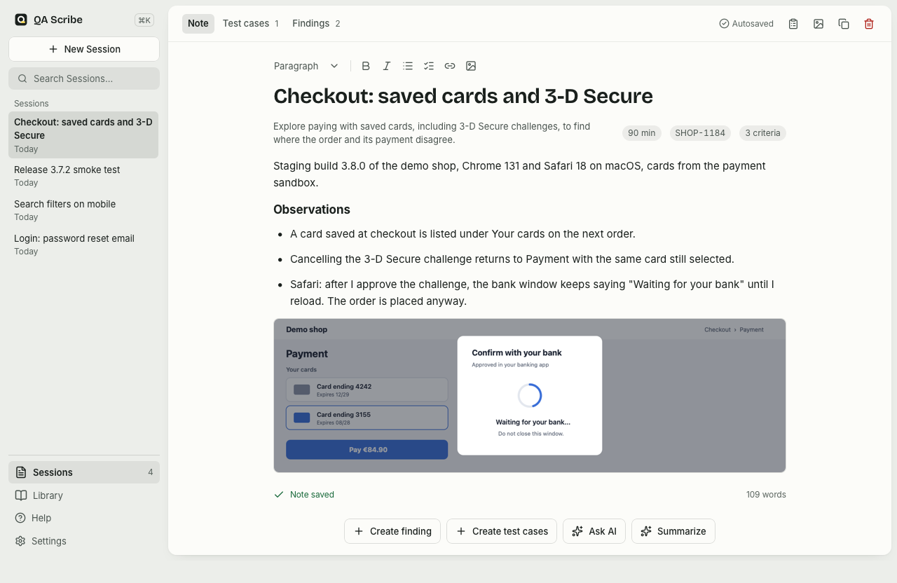
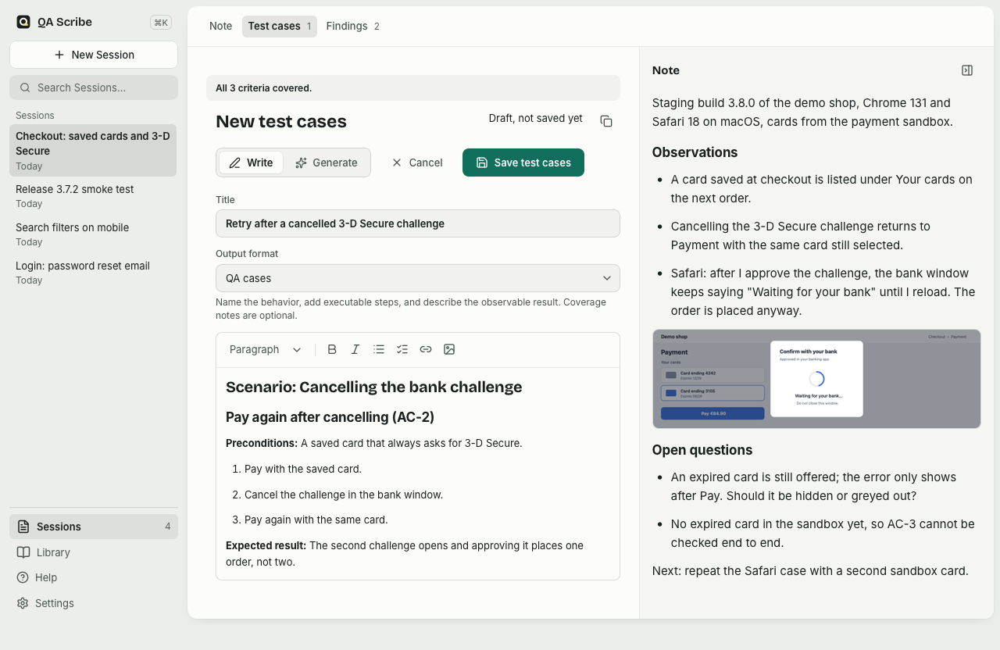
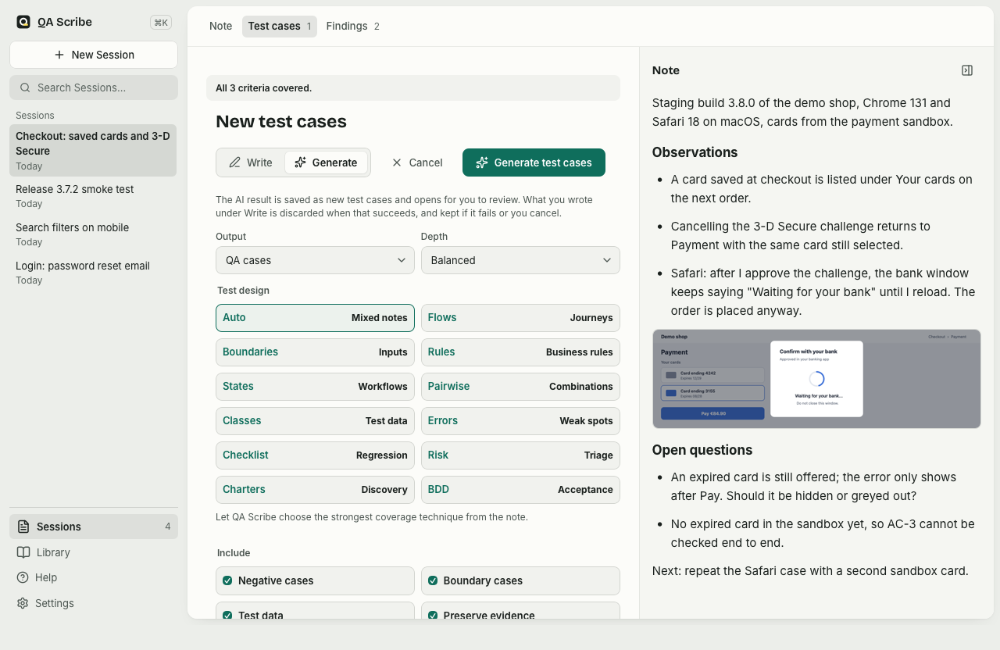
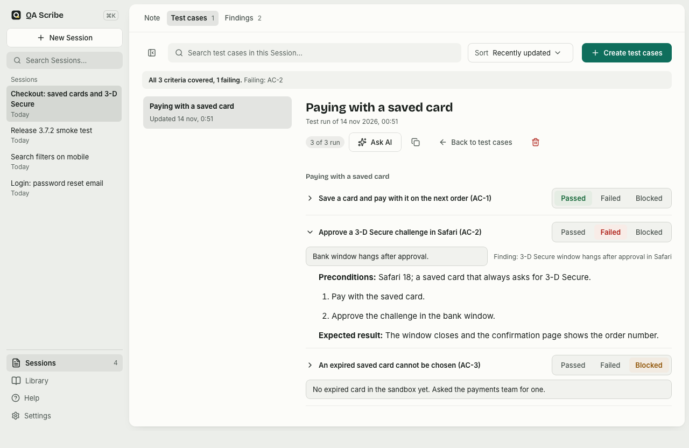
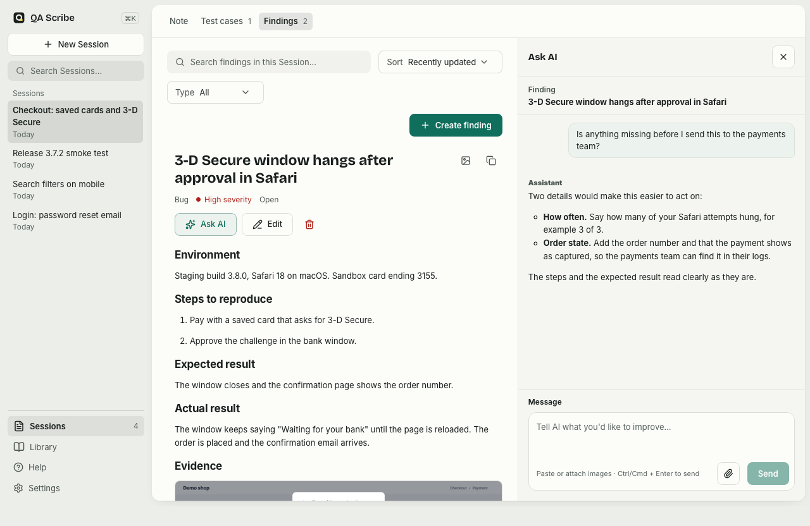

# QA Scribe


A local-first desktop notepad for exploratory testing. Capture evidence during a Session, track Findings, and turn your notes into editable Testware Drafts.

[Get started](docs/getting-started.md) · [Download](https://github.com/ddv1982/qa-scribe/releases) · [Wiki](https://github.com/ddv1982/qa-scribe/wiki) · [Development](docs/development.md)

<picture>
  <source media="(prefers-color-scheme: dark)" srcset="docs/images/note-dark.png">
  
</picture>

## What you can do

- Organize testing Sessions with context, objectives, and a chronological Timeline.
- Capture Notes, API responses, logs, screenshots, and attachments.
- Link Findings to their supporting Evidence.
- Start a Finding or test cases from the Note or its collection; the Note stays beside the new draft so you can read it while you write. Choose Write to author it in a manual output format or finding template and save it yourself, or Generate to have optional AI draft it from the Note. Session Chat accepts pasted or chosen images. Testware remains the domain umbrella for testing output.
- Use Copy on a Note, test case, Finding, or selected library record. Library copying keeps the current Session and uses the saved output.
- Use Copy first screenshot to copy the first managed screenshot in a Note or record.

Capture and editing work without AI. Optional AI uses your authenticated local Claude Code, Codex CLI, or GitHub Copilot CLI. QA Scribe does not store provider API keys.

## A look inside

New test cases in Write mode: you write QA cases yourself, with the Session Note open beside the draft.



The same draft in Generate mode, where optional AI drafts the test cases from the Note with the output, depth and test design you choose.



A Test run of saved Test cases: each test case gets a Result and an optional Remark, and the failed one links to its Finding.



A saved Finding with its severity and steps to reproduce, and Ask AI open beside it.



## Install

Get the latest build from [GitHub Releases](https://github.com/ddv1982/qa-scribe/releases).

- **macOS:** Open the `.dmg` and drag QA Scribe into Applications. Choose `aarch64` for Apple Silicon or `x64` for Intel.
- **Linux:** Install the `.deb` or `.rpm`, or run the `.AppImage`.

For Debian and Ubuntu, enable the signed APT repository:

```bash
bash <(curl -fsSL https://ddv1982.github.io/qa-scribe/install-apt-repo.sh)
sudo apt update
sudo apt install qa-scribe
```

The bootstrap verifies the repository setup package with the pinned signing key. Later updates use your normal APT workflow.

## Tech stack

- **Desktop and backend:** Rust and Tauri 2.
- **Interface:** React 19, TypeScript, Vite, and Tiptap.
- **Storage:** SQLite through `rusqlite`, with managed attachment files.
- **Typed bridge:** Tauri commands, Serde, and Specta-generated TypeScript bindings.
- **Tooling:** Bun, the Rust `tsc-rs` compiler and language server, the Microsoft TypeScript 7 extension client, and Oxlint with its Go-based typed-lint engine.
- **AI:** Local CLI processes for generation and Chat.

## Develop

Contributor setup, toolchains, editor configuration, and checks are in the [development guide](docs/development.md). For a first testing task, follow [Get started](docs/getting-started.md). Optional AI setup is in [AI providers and Session Chat](docs/ai-providers.md).

## Data and privacy

Sessions and Drafts live in local SQLite. Attachments are managed files in the app-data directory. Deleting a Session removes its database records and attachments. Older Electrobun databases are not migrated.

Deleting a Finding removes its Evidence links. Deleting a Draft preserves its AI Run history.

AI generation sends the selected context and attachment metadata, without raw attachment binaries. Sending a Chat image sends its pixels to the selected CLI, including when that conversation is replayed. Chat tools and connectors use the selected CLI's permissions. See the [AI guide](docs/ai-providers.md) for the full behavior.

## Project layout

```text
crates/qa-scribe-core/  Domain, SQLite, attachments, and generation
crates/qa-scribe-app/   Non-GUI smoke harness
src-tauri/             Desktop shell and Tauri commands
frontend/              React interface and typed bridge
docs/                  Guides, architecture, and research
```

## More information

- [Project wiki](https://github.com/ddv1982/qa-scribe/wiki)
- [Product terminology](CONTEXT.md)
- [Architecture decisions](docs/adr)
- [Quality scenarios](docs/quality-scenarios.md)
- [Release process](docs/releasing.md)
