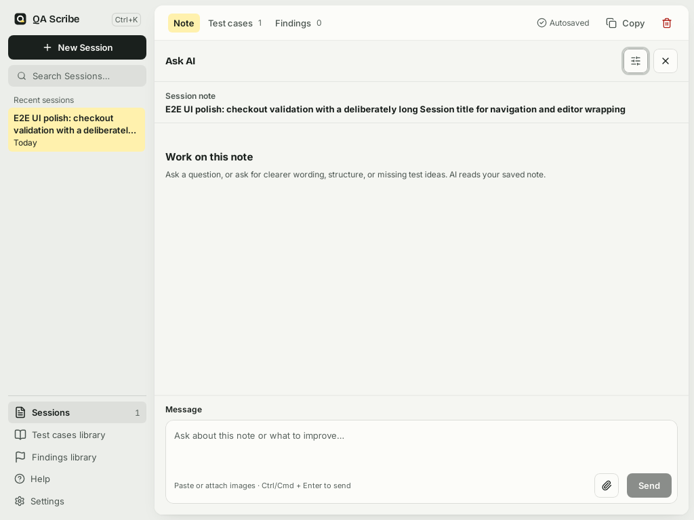
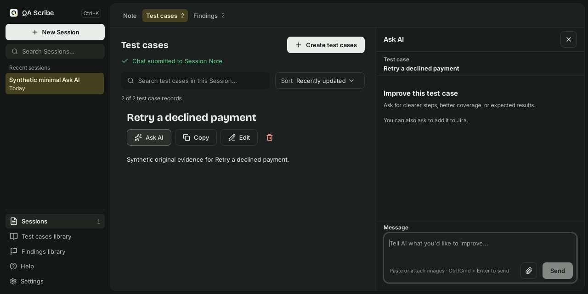
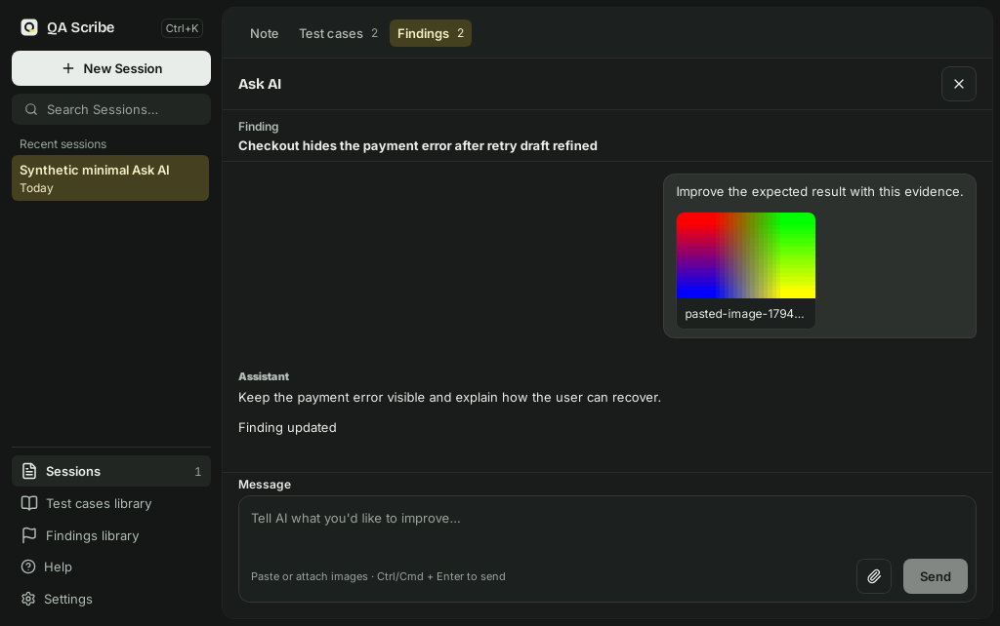

# Ask AI target spec

Status: **draft for approval** (project health plan P3.3). Nothing in here gets built until it's approved. Mockups: [mockup.html](design/ask-ai-spec/mockup.html). Gaps against today's app: [Gap list](#gap-list).

This replaces the seven earlier Ask AI plans and designs, now in [archive](archive/README.md). If this spec and an archived plan disagree, this spec wins.

## Goal

Ask AI is one assistant that works on the thing you're looking at. It should look and behave the same next to a Note, a Test case or a Finding. Learn it once, and you can use it everywhere.

## Principles

1. **One panel.** Every panel has the same anatomy, controls, wording pattern and states. The only differences are the ones listed under [Allowed differences](#allowed-differences).
2. **The thing you're working on is always the context.** The panel always sends the saved Note, Test case or Finding. You never have to paste it in or pick a mode.
3. **Suggestions, not silent edits.** The AI never changes your work by itself. A change shows up as a suggestion card that you apply with one button, and you can undo it.
4. **Quiet by default.** The conversation and the composer are visible at all times. Everything else (model, setup, starting over, limits) sits behind one options icon.
5. **Plain language.** Labels use the noun of the thing you're working on: "Update note", "Update finding", "Update test case". The panel never uses internal words like proposal, refinement, staged, contract or transcript.

## Anatomy (top to bottom)

| Part | Content | Rules |
| --- | --- | --- |
| A1 Header | The title "Ask AI", an options icon (sliders), and Close (X) | The same three controls, in the same order, in every panel. |
| A2 Source line | The kind of thing (Note, Test case or Finding) above its title | One line, truncated with the full title on hover. If the source is loading, missing or failed, this line shows that state with "Try again". |
| A3 Conversation | The messages, newest at the bottom | Scrolls by itself. Each message keeps its own suggestion card. |
| A4 Composer | A text box, attach image, and Send (or Stop while the AI is working) | Always visible. Placeholder: "Ask AI to improve this {noun}…". |
| A5 Footer | Notes only: "Add conversation to note" | Hidden until the conversation has at least one reply. |

The **options menu** (behind the sliders icon) holds the same items in every panel:

- the model picker;
- "Configure AI" (opens Settings, AI);
- "New conversation" (asks for confirmation when the conversation has messages);
- the usage line ("12 / 128 messages · 3.4 / 128 KiB").

It closes on Escape or a click outside, and never covers the composer.

## States

| State | What shows |
| --- | --- |
| S1 Empty | A heading "Improve this {noun}", plus 3 example prompts as buttons that fill the composer (they do not send). Examples: Note: "Make this note clearer", "Turn this into steps", "What did I miss?". Test case: "Make the steps clearer", "Add expected results", "Add edge cases". Finding: "Make this easier to reproduce", "Suggest a severity", "Add the expected result". |
| S2 Working | After Send: the user message, then a status row ("Thinking…" or "Writing a suggestion…") with Stop. |
| S3 Reply | Assistant text. If the reply suggests a change, a suggestion card follows it (see below). |
| S4 Error | An inline message under the failed turn, with Retry. The composer keeps your text. |
| S5 AI unavailable | One message in place of the composer: the reason, plus "Configure AI". Nothing else in the panel changes. |
| S6 Tool permission | A card above the composer: what the AI wants to run, with "Allow once" and "Deny". |
| S7 Source unavailable | The source line explains why (A2). Earlier messages stay readable. Send is disabled with the same reason as a tooltip. |

## Suggestion card

The same card in all three panels:

1. **Suggested.** A heading "Suggested {noun}", the suggested content rendered read-only, and one primary button "Update {noun}". A Finding also lists its changed fields (severity, status, component, reference) under the content.
2. **Applied.** The card collapses to "{Noun} updated" with an "Undo" button. Undo restores what was there before and shows the Suggested state again.
3. **Out of date.** If the {noun} changed after the suggestion was made, Update is disabled with: "The {noun} changed after this suggestion. Ask AI again to get a fresh one."

There is no separate review toggle, "Apply to editor", "Dismiss" or "Keep current edits". Ignoring a suggestion is dismissing it.

Saving: Update writes the saved {noun}. Pending edits in the open editor are saved first. If that save fails, nothing is applied and the card shows the error.

## Allowed differences

| Aspect | Note | Test case | Finding |
| --- | --- | --- | --- |
| Noun | note | test case | finding |
| Where it opens | The "Ask AI" button in the Note toolbar | The "Ask AI" button on the record | The "Ask AI" button on the record |
| Extra fields in the suggestion | none | title | title and finding fields |
| Footer | "Add conversation to note" | none | none |
| Example prompts | Note set | Test case set | Finding set |

Anything not in this table must be identical.

**Test run (read-only).** A test run also has Ask AI, on its run screen before Copy report. It is the one source the panel only reads: the source line says "Test run" above "{draft title}, {run date}", every message sends the test run report (draft title, run date, totals, each case with its result, remark and linked Finding) built from the stored results, and there is no suggestion card, Update action or Jira-draft action. The AI can use the CLI's tools under the usual permission prompts, for example to post the results to Jira or Confluence, but it can never set or rewrite a result. The panel closes when the tester goes back to the test cases, opens another test run or draft, or leaves the Test cases tab. See [ADR 0012](adr/0012-test-runs-are-frozen-copies.md).

## Keyboard and focus

- Opening the panel focuses the composer. Closing returns focus to the button that opened it.
- Enter sends and Shift+Enter starts a new line. Escape closes the options menu first, then the panel.
- Every control has a visible focus ring and an accessible name. A status change ("Note updated", an error) is announced through a live region.

## Gap list

This is today's app (v0.8.35) checked against the spec. The screenshots come from the native E2E suite (Linux, 2026-11-11):

| Note, empty | Test case, empty | Finding, after Update |
| --- | --- | --- |
|  |  |  |

The Test case empty state also says "You can also ask to add it to Jira." The example prompts in S1 replace that line.

| # | Spec point | Note | Test case / Finding | Evidence |
| --- | --- | --- | --- | --- |
| G1 | A1: the options icon in every panel | met | **not met**: no options icon, so you can't pick a model or start a new conversation | `AppChat.tsx` passes options to the Notes panel only |
| G2 | A4: one placeholder pattern | **not met**: "Ask about this note or what to improve…" | **not met**: "Tell AI what you'd like to improve…" | `SessionChatView.tsx:333` |
| G3 | S1: "Improve this {noun}" with example prompts | **not met**: "Work on this note", no examples | partly: the heading matches, but there are no examples | `SessionChatView.tsx:276-283` |
| G4 | Applied: "{Noun} updated" with Undo | met | **not met**: "Finding updated" has no Undo | `ChatProposalReview.tsx:37` |
| G5 | One suggestion card | met | met | Conversations from v0.8.22 to v0.8.34 still show the older review card ("Review refinement", "Apply to editor", "Dismiss proposal") through `BoundNotes` (`ChatProposalReview.tsx:51-75`) |
| G6 | A2: the source line names the kind | **not met**: the eyebrow says "Session note" | met ("Test case", "Finding") | `AppChat.tsx:41,80` |
| G7 | S2: the working status wording | partly: "Preparing reply" | partly: "Preparing suggested changes" | `SessionChatView.tsx:294` |
| G8 | A5: footer hidden until the first reply | **not met**: it appears, disabled with a reason, as soon as the first message is sent | n/a | `SessionChatView.tsx:301` |
| G9 | The usage line lives in options | met | **not met**: not shown at all (follows from G1) | |

Implementation items get added to the project health plan only after this spec is approved.
